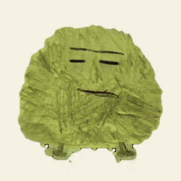

<p align="center">
  
</p>

# Blobb

A short story-driven puzzle platformer made from a child's crayon drawing.

Two narrators you never see tell Blobb's story, and what they say changes the world as you
play: the colours, the style, the objects in it, even the rules. One line grows branches,
another decides that crates float, a third lets Blobb swim. When Blobb falls, nobody dies:
the younger narrator objects ("He didn't fall!") and the story is told again.

Underneath, it is a story about two people telling a story together while one of them is in
hospital. It is told in English or Swedish.

## The chapters

1. **The Other Side of the Forest** (*Andra sidan skogen*): a crayon forest and a box-pushing clearing.
2. **Learning to Swim** (*Lära sig simma*): a millpond with whirlpools, then a water-stream puzzle in an old mill.
3. **Lights** (*Ljus*): a town at night, a light-bridge puzzle on the rooftops, and a rooftop lane runner on the beat.
4. **The Other Half** (*Den andra halvan*): a dream that can't settle on a look, and the foot of a mountain.
5. **The Climb** (*Klättringen*): up the mountain at night on heartbeat ledges, into a full night sky.

## Controls

| | Keyboard | Controller |
|---|---|---|
| Move | Arrow keys | Stick |
| Jump / next line | Space | Ⓐ |
| Use (wheels, holds, look at the drawing) | E | Ⓑ |
| Hurry the text | Tab | RB |
| Undo / start the room again (puzzles) | Z / R | Ⓧ / Ⓨ |
| Pause | Esc | Start |

## Running it

Blobb is made with [Godot](https://godotengine.org) 4.7 (GL Compatibility renderer).

```sh
godot --path .                      # play
./run.sh                            # play, re-importing assets first
./play.sh                           # lists scenes you can jump straight into, e.g. ./play.sh roofs 2
```

On the title screen, **F1** opens a test menu with every scene.

**In a browser:** export with the "Web" preset (single-threaded, so any static file server
works, no special headers):

```sh
godot --headless --path . --export-release "Web" build/web/index.html
python3 -m http.server 8060 -d build/web    # then open http://localhost:8060
```

**Tests** (puzzle rules and solvers, the story scripts, saving):

```sh
for t in test_sokoban test_story test_flow test_beams test_save; do
  godot --headless --path . --script res://tests/$t.gd
done
```

## How it's built

- **Everything is built in code.** Each level is a bare scene with a script that builds its
  terrain, collisions and actors from data tables. The puzzles keep their rules in plain
  classes, each with a BFS solver (mirrored in Python under `tools/`) that proves every room
  can be solved and finds its shortest solution.
- **The dialogue is a play script.** Each chapter's story lives in `chapters/<n>/story.txt`
  (`O:` and `Y:` lines, a Swedish line under each, and `@effects` that the level carries out).
  Level code only decides *when* a scene is told.
- **The look changes live** through a full-screen post-process shader (paper, crayon, dark,
  mono, real, plain) and a shader that recolours Blobb.
- **Blobb himself** is the child's drawing, animated: the original crayon figures were cut out
  of a photo of the drawing, and his animations were made from that drawing.

More detail for contributors is in [CLAUDE.md](CLAUDE.md), and the story rules and chapter
plans are in [docs/story.md](docs/story.md).

## How it was made

Blobb was made by a parent and their child. The child drew Blobb; the parent directed the
game, played it through again and again, and found what didn't work.

The code, dialogue and tools were written with [Claude Code](https://claude.com/claude-code)
(Claude Opus), working from that direction. Most of the art beyond the child's drawing was
generated with Stable Diffusion XL in ComfyUI, also driven by Claude, or drawn in code. The
sounds and music are synthesised by the scripts in `tools/`. `USAGE.md` keeps a rough log of
the tokens used.

## Licences

The drawing of Blobb belongs to the child who made it. Fonts (Lora, Patrick Hand under the
SIL Open Font License; a FreeSans subset under the GPL with the font exception), Godot and
other third-party parts are listed with their licences in [LICENSES.txt](LICENSES.txt);
Godot's own third-party components are in [licenses/godot-thirdparty.txt](licenses/godot-thirdparty.txt).
